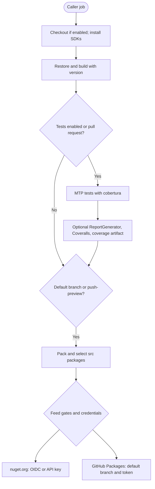

# gha-dotnet-nuget

`gha-dotnet-nuget` is a composite GitHub Action for .NET package maintainers: restore, build, test with Microsoft.Testing.Platform, pack, and optionally publish to nuget.org and GitHub Packages.

[](https://github.com/marketplace/actions/net-build-test-pack-push)
[](https://github.com/f2calv/gha-dotnet-nuget/actions/workflows/ci.yml)

The [Action contract](https://github.com/f2calv/gha-dotnet-nuget/blob/main/action.yml) installs .NET SDKs 8, 9 and 10. Use a Linux runner with Bash, `jq` and GNU `find` (for example `ubuntu-24.04`). Package projects must be packable; set `IsPackable` to `false` for projects that must not ship. Push discovery searches `src/**/*.nupkg`, so custom pack output outside `src/` will not be published.

## Usage

Call the Action as a **step**, not a reusable-workflow job. This build-only caller needs no publishing credentials:

```yaml
name: packages
on: [push, pull_request]
permissions: {}
jobs:
  build:
    runs-on: ubuntu-24.04
    permissions:
      contents: read
    steps:
      - uses: f2calv/gha-dotnet-nuget@v2
        id: packages
        with:
          version: 1.2.3
          push: false
```

`@v2` is the published floating-major Action reference; [v2.3.4](https://github.com/f2calv/gha-dotnet-nuget/releases/tag/v2.3.4) is an available immutable release. Do not use floating minor or patch aliases.

The Action checks out the caller repository itself. With `checkout: false`, the caller must first provide the source tree. `checkout-ref` changes the checked-out code, **not** the branch used by publishing gates.

### Publish packages

Trusted Publishing exchanges GitHub's OIDC token for a short-lived nuget.org key. Configure a matching Trusted Publisher policy on nuget.org for the caller repository, workflow filename and environment (if used). The caller job grants the permissions; the composite Action cannot grant them:

```yaml
jobs:
  publish:
    if: github.event_name == 'push' && github.ref == 'refs/heads/main'
    runs-on: ubuntu-24.04
    permissions:
      contents: read
      id-token: write
      packages: write
    steps:
      - uses: f2calv/gha-dotnet-nuget@v2
        with:
          version: 1.2.3
          GITHUB_TOKEN: ${{ secrets.GITHUB_TOKEN }}
          nuget-user: ${{ vars.NUGET_USER }}
```

This is a caller-job fragment; use it in a workflow with a `push` trigger. Replace the example package version with your calculated version. Omit `GITHUB_TOKEN` and `packages: write` when publishing only to nuget.org. Omit OIDC permission and `nuget-user` when publishing only to GitHub Packages. The default token must have access to the destination package.

## Inputs

| Input | Type | Required | Default | Description |
| ----- | ---- | -------- | ------- | ----------- |
| `version` | string | ✅ | | NuGet package version e.g. `1.2.301-feature-my-feature.12` |
| `GITHUB_TOKEN` | string | | | GitHub token to push to GitHub Packages e.g. `${{ secrets.GITHUB_TOKEN }}` |
| `nuget-user` | string | | | nuget.org profile username of the Trusted Publishing policy creator |
| `NUGET_API_KEY` | string | | | **DEPRECATED**, superseded by `nuget-user`. Ignored when `nuget-user` is set. |
| `checkout` | boolean | | `true` | Checkout the current repository |
| `checkout-ref` | string | | | Git ref to checkout e.g. `v1.2.3` or a commit SHA. Empty checks out the triggering ref. |
| `configuration` | string | | `Release` | .NET build configuration e.g. `Debug` or `Release` |
| `solution-name` | string | | | .NET solution or project to build e.g. `MySolution.slnx` or `MyProject.csproj`. Empty targets the working directory. |
| `push` | boolean | | `true` | Push packages to NuGet feeds |
| `push-preview` | boolean | | `false` | Push a pre-release NuGet package from a non-default branch. The version's SemVer pre-release suffix signals preview status to NuGet. |
| `execute-tests` | boolean | | `true` | Execute unit tests |
| `code-coverage` | boolean | | `true` | Execute code coverage tools |
| `dotnet-restore-args` | string | | | Optional extra arguments for `dotnet restore` |
| `dotnet-build-args` | string | | | Optional extra arguments for `dotnet build` |
| `dotnet-test-args` | string | | | Whitespace-split extra `dotnet test` arguments; not JSON and not shell-quote-aware |
| `dotnet-pack-args` | string | | | Optional extra arguments for `dotnet pack` |
| `dotnet-push-args` | string | | | Optional extra arguments for `dotnet nuget push` |
| `package-filter` | string | | | Comma-separated list of package ID prefixes to push e.g. `CasCap.Common.Caching,CasCap.Common.Extensions`. When empty all packages are pushed. |

`execute-tests` and `code-coverage` are opt-out controls. An empty value does not override their safe
defaults, and `execute-tests: false` is ignored on pull requests so a missing dispatch-only boolean
cannot silently remove the required test gate. Explicit opt-out remains available on other events.

## Push behaviour

| Scenario | nuget.org | GitHub Packages |
| --- | --- | --- |
| Default branch, `push: true` | With credential | With token |
| Default branch, `push: false`, `push-preview: false` | No | No |
| Any branch, `push-preview: true` | With credential, even if `push: false` | Only default branch with `push: true` |
| Non-default branch, `push-preview: false` | ❌ | ❌ |

Packing runs on the default branch or when `push-preview: true`, even with `push: false`. On other branches the Action only builds/tests. `push-preview` is an independent nuget.org publishing opt-in, not a pre-release-version validator: supply a version such as `1.2.3-preview.4` yourself. GitHub Packages publication is branch-gated, not version-suffix-gated. Keep publishing jobs restricted to trusted events; the Action does not independently exclude pull requests.

Credential per feed:

- **nuget.org** — the short-lived key exchanged via Trusted Publishing when `nuget-user` is set, otherwise the deprecated `NUGET_API_KEY`. When neither is supplied the push is skipped with a warning.
- **GitHub Packages** — always `GITHUB_TOKEN`; Trusted Publishing does not apply.

### Package filtering

When `package-filter` is set, only `.nupkg` filenames beginning with a trimmed prefix followed by `.` are pushed. This is a filename-prefix filter, not exact package-ID matching or change detection.

For example, if a solution produces `Example.Caching` and `Example.Serialization`, setting `package-filter: Example.Caching` selects the caching package and any package whose filename starts with `Example.Caching.`.

## Testing and code coverage

The [test script](https://github.com/f2calv/gha-dotnet-nuget/blob/main/.scripts/dotnet-test.sh) requires [Microsoft.Testing.Platform](https://learn.microsoft.com/dotnet/core/testing/unit-testing-with-dotnet-test#mtp-mode-of-dotnet-test). Merge this selection into the caller's `global.json`:

```json
{
  "test": {
    "runner": "Microsoft.Testing.Platform"
  }
}
```

The action fails before testing when the file or selection is absent. VSTest fallback is deliberately
unsupported: `xunit.v3` 4.0.0 dropped the VSTest bridge, and this action follows the forward-only
.NET 10 test model.

MTP does not accept a positional path, so `solution-name` is translated into `--solution` (for `.sln` / `.slnx`) or `--project` (for `.csproj`). Any other value fails the step with an explicit error.

Coverage is collected by the [`Microsoft.Testing.Extensions.CodeCoverage`](https://learn.microsoft.com/dotnet/core/testing/unit-testing-platform-extensions-code-coverage) package, which each test project must reference. Remove these VSTest-era packages:

- `Microsoft.NET.Test.Sdk` — set `<OutputType>Exe</OutputType>` in the test project when removing it
- `xunit.runner.visualstudio`
- `coverlet.collector`
- `coverlet.msbuild`

`code-coverage: false` skips ReportGenerator, Coveralls and artifact upload; it does **not** remove the test script's coverage arguments. Test projects still need the coverage extension whenever tests execute. `execute-tests: false` is ignored on pull requests. MTP selection and compatible test projects are caller prerequisites, not automatically migrated by this Action.

### Coverage pipeline

1. `dotnet test` writes a cobertura report per test project and gathers the reports into `coverage/`.
2. `ReportGenerator` reads cobertura from `coverage/` and normalises it to lcov under `coveragereport/`.
3. Coveralls consumes the generated lcov, and `coveragereport/` is published as a build artifact.

## Outputs

| Output | Description |
| ------ | ----------- |
| `configuration` | Final build configuration used e.g. `Debug` or `Release`. Note: when `configuration` is passed via `workflow_dispatch` the value may be an empty string, so this output always provides a valid non-empty value. |

Read it as `${{ steps.packages.outputs.configuration }}` using the step ID in the first example. Packages are not uploaded as a downloadable artifact; the optional `coveragereport` artifact contains the normalized coverage output.

## Deployment Flow



## Further Reading

- [Public consuming workflow](https://github.com/f2calv/CasCap.Common/blob/main/.github/workflows/ci.yml)
- [MIT license](https://github.com/f2calv/gha-dotnet-nuget/blob/main/LICENSE)
